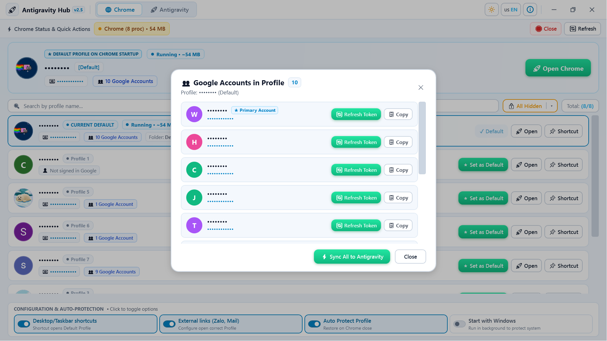
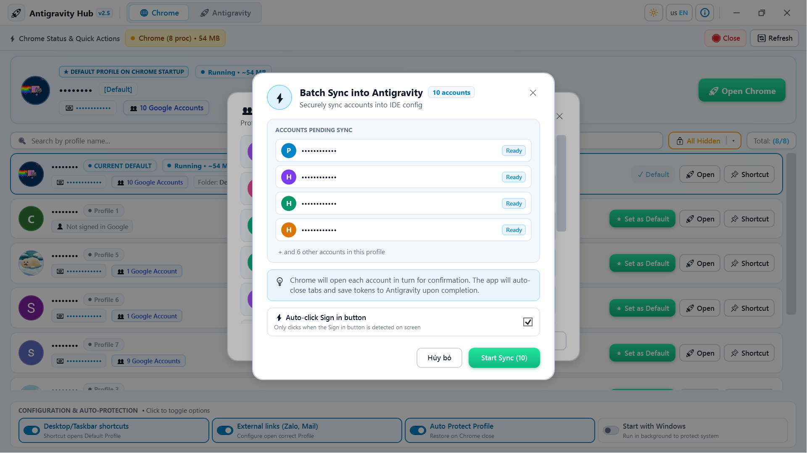
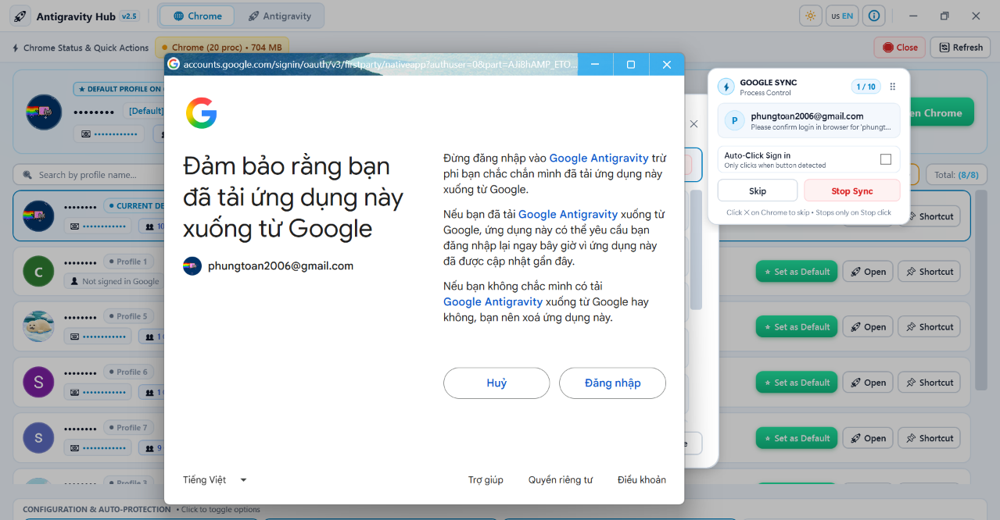

# 🚀 Antigravity Hub (v2.5 Pro)
### The Ultimate Management Suite for Antigravity AI, Model Quota Limits & Google Chrome Workspaces

<p align="center">
  
</p>

<p align="center">
  <strong>Mission Control for AI Developers & Multi-Account Google Chrome Power Users</strong>
</p>

<p align="center">
  
  
  
  
  
</p>

<p align="center">
  🌐 <strong>Documentation Language:</strong><br />
  <a href="README.md"><b>🇺🇸 English (Default)</b></a> &nbsp;&nbsp;|&nbsp;&nbsp;
  <a href="README_VI.md"><b>🇻🇳 Tiếng Việt (Vietnamese)</b></a>
</p>

---

## 📑 Table of Contents
1. [Overview](#-overview)
2. [Core Features](#-core-features)
   - [Subsystem 1: Antigravity AI Ecosystem & Quota Monitor](#1-antigravity-ai-ecosystem--quota-monitor)
   - [Subsystem 2: Google Chrome Profile & Workspace Manager](#2-google-chrome-profile--workspace-manager)
   - [Subsystem 3: Google-to-Antigravity 1-Click & Batch Sync](#3-google-to-antigravity-1-click--batch-sync)
   - [Subsystem 4: User Experience & Privacy Shield](#4-user-experience--privacy-shield)
3. [Download & Installation](#-download--installation)
4. [User Guide](#-user-guide)
   - [Managing Antigravity AI Accounts & Quota](#managing-antigravity-ai-accounts--quota)
   - [Setting 3-Tier Default Chrome Profile](#setting-3-tier-default-chrome-profile)
   - [Synchronizing Google Accounts to Antigravity (Batch Sync & Auto-Consent)](#synchronizing-google-accounts-to-antigravity-batch-sync--auto-consent)
   - [Chat Session Backup & Restoration](#chat-session-backup--restoration)
   - [Switching App Language (English / Vietnamese)](#switching-app-language-english--vietnamese)
5. [Build & Packaging Guide](#-build--packaging-guide)
6. [Project Architecture](#-project-architecture)
7. [Author & Contact](#-author--contact)

---

## 🌟 Overview

**Antigravity Hub** is a professional desktop application for Windows built to solve two critical developer workflow challenges:
1. **Antigravity AI Multi-Account Management (IDE & CLI):** Enables instantaneous, zero-crash hot account switching across developer accounts, real-time quota tracking (Gemini 2.5 Pro/Flash, Claude 3.5 Sonnet...), automated background token refreshes, and seamless chat session protection & restoration.
2. **Google Chrome Multi-Workspace Enforcement:** Delivers an exclusive 3-layer default profile locking mechanism (Local State + Windows Shortcuts + Registry URI associations), backed by a persistent background watchdog service that auto-restores your primary profile whenever Chrome exits.

Engineered natively on **.NET 9.0 WPF**, the application boasts modern Windows 11 Fluent design, glassmorphism aesthetics, dual English/Vietnamese localization, and buttery-smooth 60 FPS animations.

---

## ⚡ Core Features

### 1. Antigravity AI Ecosystem & Quota Monitor

<p align="center">
  
  <br />
  <em>📸 Antigravity AI Control Center: Real-time multi-model quota gauges, 5h/weekly restore countdowns & Zero-Crash hot account switcher</em>
</p>

* 🔄 **Zero-Crash Hot Account Switching:**
  - Switch between dozens of AI accounts with a single click without restarting your machine or losing IDE state.
  - Flexible target selection: **Antigravity IDE**, **Antigravity CLI (`agy`)**, or **Antigravity Standalone**.
* 📊 **Comprehensive Model Quota Dashboard:**
  - Real-time tracking of both **5-Hour Quotas** and **Weekly Quotas**.
  - Detailed quota breakdowns per AI model: Gemini 2.5 Pro, Gemini 2.5 Flash, Claude 3.5 Sonnet, Claude 3.5 Haiku, Claude Opus, and more.
  - **Live Restoration Countdown Timers:** Pinpoint accuracy on when each model will recover full quota.
* 🤖 **Automated Token Refreshes & Background Batch Measurement:**
  - Periodic background quota evaluation (configurable intervals: 15m, 30m, 1h...).
  - Multi-threaded concurrency control ensures rapid checks across dozens of accounts without API throttling.
* 💾 **Chat Session Backup & Seamless Restoration:**
  - Automatically snapshots chat state (`chatSessionStore.json`, `trajectorySummaries`, sidebar workspaces) before switching accounts.
  - Seamlessly restores in-flight conversations to the new account.
* 🔐 **Silent OAuth & Consent Automation:**
  - Integrated local OAuth listener and consent helper for frictionless Google account authentication.

---

### 2. Google Chrome Profile & Workspace Manager

<p align="center">
  
  <br />
  <em>📸 Google Chrome Workspace Manager: 3-tier default profile lock, Profile Guard background watchdog & Live RAM telemetry</em>
</p>

* 🎯 **Exclusive 3-Tier Default Profile Enforcement:**
  - **Tier 1 – Chrome Internal Config (`Local State`):** Enforces `profile.last_used` and suppresses the startup profile picker modal (`show_picker_on_startup: false`).
  - **Tier 2 – Automated Windows Shortcut Synchronization:** Automatically updates all Desktop, Taskbar, and Start Menu shortcuts with `--profile-directory="<Profile>"`.
  - **Tier 3 – External Link Registry Redirection (`ChromeHTML`):** Configures `HKCU\Software\Classes\ChromeHTML`, guaranteeing that links clicked from Slack, Discord, Telegram, Outlook, or Word always open inside your primary profile.
* 🛡️ **Profile Guard Watchdog Service:**
  - Silently monitors Chrome launch and exit events in the background.
  - Automatically restores your default profile as soon as Chrome closes, preventing temporary profile switches from altering your defaults.
* 📈 **Real-Time Chrome Process & Memory Analytics:**
  - Live statistics displaying Chrome process counts and total RAM consumption.
  - One-click quick-action button to clean up or restart all Chrome processes instantly.

---

### 3. Google-to-Antigravity 1-Click & Batch Sync

Seamlessly bridge your Google Chrome profiles with the Antigravity AI ecosystem. Import logged-in Google identities and inject authorized OAuth credentials straight into Antigravity Hub with automated browser interaction.

<p align="center">
  
  <br />
  <em>📸 Profile Account Inspector: View all Google accounts inside any Chrome profile, check synchronization state, copy emails, or launch sync with 1 click</em>
</p>

* 🔍 **Deep Profile Account Discovery:**
  - Instantly inspect and enumerate all signed-in Google accounts inside any selected Chrome profile without opening the browser.
  - Clear visual synchronization badges indicate whether an account is already imported into Antigravity Hub or pending synchronization.
  - Quick utility actions per account: Individual **Sync to Antigravity**, **Copy Email**, and Privacy Masking.

<p align="center">
  
  <br />
  <em>📸 Batch Sync Modal: Configure automated batch onboarding with Auto-Click Sign-in and Auto-Close tab workflows</em>
</p>

* ⚡ **High-Speed Batch Sync Pipeline:**
  - Queue multiple Google accounts from a profile for automated sequential synchronization.
  - Eliminates tedious repetitive manual sign-ins when managing large account pools.
  - Configurable options: **Auto-Click Sign-in** (hands-free OAuth consent automation) and **Auto-Close Tab on Finish**.

<p align="center">
  
  <br />
  <em>📸 Batch Sync HUD & Live Telemetry: Floating progress bar docked during automated sign-in with Skip and Stop controls</em>
</p>

* 🤖 **Smart Auto-Consent & Auto-Click Sign-in (`GoogleOAuthAutoConsentService`):**
  - Automates browser-level OAuth confirmation: detects account selection buttons, clicks consent prompts, and captures authentication tokens via a secure local loopback listener.
  - Automatically closes the browser authentication tab as soon as tokens are secured.
* 🪟 **Docked Batch Sync Floating Bar:**
  - An unobtrusive, modern floating HUD displays real-time progress (`Account X of Y`, current email, visual progress meter) while docking near the top/bottom of the screen.
  - Offers immediate control: **Skip** the current account or **Stop Sync** anytime without locking the main application or disturbing your IDE.
* 🔒 **Local Token Security:**
  - Tokens and credentials are stored strictly in local configuration files (`AppConfig` / local secure storage) with zero external relay servers.

---

### 4. User Experience & Privacy Shield

* 🌐 **Full Bilingual Support (Instant Switch 🇻🇳 VI / 🇺🇸 EN):**
  - Instant toggle button located directly on the **top-right title bar**.
  - With **a single click**, all UI text, buttons, tooltips, and dialogs switch instantaneously between **Vietnamese** and **English** with zero restart needed.
* 🌓 **Fluent Light & Dark Themes:** Smooth transition between sleek dark mode and radiant light mode matching OS preferences.
* 👁️ **Privacy Shield Mode:** Masks sensitive account names and email addresses during screen sharing, tutorials, or live streams.
* 🔔 **System Tray Integration:**
  - Minimizes gracefully to the notification area upon window closure.
  - Right-click tray menu for fast profile switching, launching Chrome, or restarting IDEs.
  - Optional "Start with Windows" toggle.

---

## 📦 Download & Installation

Choose between the two distribution options:

| Edition | Format | Description & Recommendation | Direct Path |
| :--- | :--- | :--- | :--- |
| **Setup Installer** | `*.exe` Installer | Standard Windows installer with Desktop & Start Menu shortcuts, UAC elevation handling, and clean uninstaller. *(Recommended)* | [`dist/Setup/AntigravityHub_Setup_v2.5.exe`](file:///c:/Users/admin/source/repos/ProxySwicher/dist/Setup/AntigravityHub_Setup_v2.5.exe) |
| **Portable Edition** | `*.exe` Single-File | Self-contained single executable. Zero installation required—run directly from any folder or USB drive. | [`dist/Portable/AntigravityHub.exe`](file:///c:/Users/admin/source/repos/ProxySwicher/dist/Portable/AntigravityHub.exe) |

> [!NOTE]
> All binaries are built as **Self-Contained 64-bit Windows executables**—**no separate .NET Runtime installation is required**.

---

## 📖 User Guide

### Managing Antigravity AI Accounts & Quota
1. Launch **Antigravity Hub** and navigate to the **🚀 Antigravity** tab.
2. Your registered accounts will appear along with real-time quota gauges.
3. **Switch Account:** Click **Activate** on your desired account. The authentication session switches instantly without disrupting your IDE.
4. **View Model Quotas:** Click the quota badge or dashboard icon on any account card to view detailed recovery timelines for each Gemini or Claude model.
5. **Measure All:** Click **Measure All Quotas** on the toolbar to refresh quota telemetry across all stored accounts concurrently.

### Setting 3-Tier Default Chrome Profile
1. Navigate to the **🌐 Chrome** tab.
2. Your Chrome profiles are listed with genuine avatars, email addresses, and account counts.
3. Click **⭐ Set as Default** on your preferred profile.
4. Toggle configuration switches in the bottom toolbar:
   - `Desktop/Taskbar shortcuts`: Updates all shortcuts.
   - `External links (Zalo, Mail)`: Routes external link clicks to this profile.
   - `Auto Protect Profile`: Enables the background watchdog service.

### Synchronizing Google Accounts to Antigravity (Batch Sync & Auto-Consent)
1. Go to the **🌐 Chrome** tab and locate the profile containing your desired Google accounts.
2. Click the **Google Accounts** button on the profile card to open the **Account Inspector** popup (`demo/GoogleAccInProfile.png`).
3. **Single Account Sync:** Click **Sync to Antigravity** next to any account to authenticate and import it individually.
4. **Batch Sync:** Click **Sync All to Antigravity** at the top right to open the batch onboarding modal (`demo/SycnAntigravity1.png`).
5. Ensure **Auto-Click Sign-in** is checked, then click **Start Sync**.
6. The **Floating Sync Bar** (`demo/SycnAntigravity2.png`) will appear on your screen, guiding the automated process step-by-step. You can click **Skip** or **Stop** at any moment.
7. Once finished, navigate back to the **🚀 Antigravity** tab to immediately view your new accounts and start managing their model quotas!

### Chat Session Backup & Restoration
- This feature works fully automatically. Before switching accounts, the application snapshots your active conversation sessions.
- You can inspect and restore past conversations from the account management drawer at any time.

### Switching App Language (English / Vietnamese)
- Click the language toggle button on the **top-right title bar header** (labeled `🇻🇳 VI` or `🇺🇸 EN`).
- The entire interface switches immediately to your selected language.

---

## 🛠️ Build & Packaging Guide

If you wish to compile or package the project from source:

### Prerequisites
* OS: Windows 10 / Windows 11 (64-bit).
* SDK: [.NET 9.0 SDK](https://dotnet.microsoft.com/download/dotnet/9.0) or higher.
* Installer Compiler: [Inno Setup 6](https://jrsoftware.org/isdl.php) (Automatically installed via `winget` by the build script if missing).

### Automated One-Click Build

Execute the build script:
```cmd
build.bat
```
Or run via PowerShell:
```powershell
.\build.ps1 -Target All
```

**Build Options:**
- `[1] Build Portable`: Generates single-file executable at `dist/Portable/AntigravityHub.exe`.
- `[2] Build Setup`: Compiles Windows installer at `dist/Setup/AntigravityHub_Setup_v2.5.exe`.
- `[3] Build ALL`: Produces both Portable and Setup packages in a single run.

---

## 📂 Project Architecture

```
ProxySwicher/
├── ProfileSwitchChrome - Sao chép/
│   ├── Models/                           # Data models & telemetry structures
│   │   ├── AntigravityAccountInfo.cs     # AI accounts, token, and quota models
│   │   └── ChromeProfileInfo.cs          # Chrome profiles, avatar caches
│   ├── Services/                         # Core domain logic & background engines
│   │   ├── AntigravityProfileManager.cs  # AI account coordinator, quota, IDE hot-reload
│   │   ├── AntigravityChatRestorer.cs    # Conversation backup & restore engine
│   │   ├── ChromeProfileManager.cs       # Local State parser & shortcut modifier
│   │   ├── ProfileGuardService.cs        # Background watchdog process
│   │   ├── GoogleOAuthAutoConsentService.cs # Smart browser auto-consent & OAuth login
│   │   ├── AppConfig.cs                  # Settings persistence & auto-migration
│   │   ├── ThemeManager.cs               # Fluent Light/Dark theme manager
│   │   └── LocalizationManager.cs        # Bilingual dictionary manager (VI/EN)
│   ├── MainWindow.xaml                   # Fluent WPF view declaration
│   ├── MainWindow.xaml.cs                # View controller & interactive handlers
│   ├── ModelQuotaWindow.xaml             # Detailed model quota telemetry window
│   ├── BatchSyncFloatingBar.xaml         # Always-on-top batch sync HUD floating bar
│   ├── app.manifest                      # Windows elevation manifest
│   ├── installer.iss                     # Inno Setup 6 packaging script
│   ├── build.bat                         # Fast build launcher
│   └── ProfileSwitchChrome.csproj        # .NET 9.0 project definition
├── dist/                                 # Build artifact outputs
│   ├── Portable/                         # Contains AntigravityHub.exe
│   └── Setup/                            # Contains AntigravityHub_Setup_v2.5.exe
├── build.bat                             # Root packaging script
├── build.ps1                             # PowerShell build pipeline
├── README.md                             # English documentation (Default)
└── README_VI.md                          # Vietnamese documentation (Tiếng Việt)
```

---

## 👨‍💻 Author & Contact

* **Author:** Phùng Toàn (*DvenxyWiks*)
* **GitHub:** [https://github.com/wiksgods](https://github.com/wiksgods)
* **Telegram:** [@DvenxyWiks](https://t.me/DvenxyWiks)
* **Current Version:** `v2.5.0 Pro`

---

<p align="center">
  Crafted with ❤️ and passion for high-performance software engineering. Empower your daily AI workflow with <strong>Antigravity Hub</strong>!
</p>
