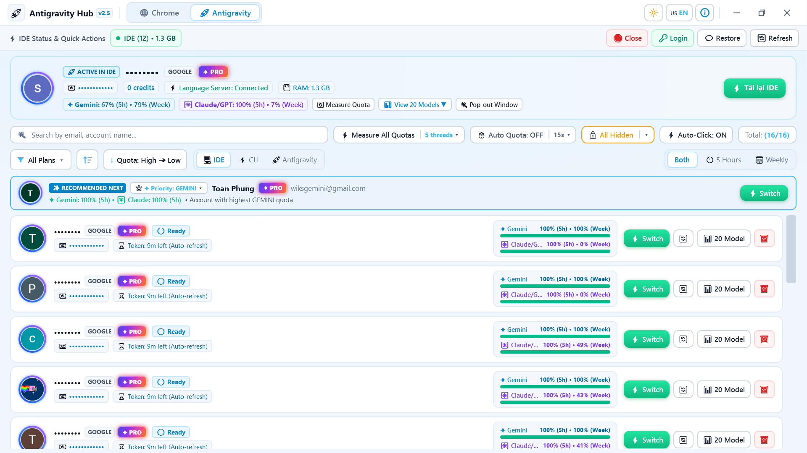
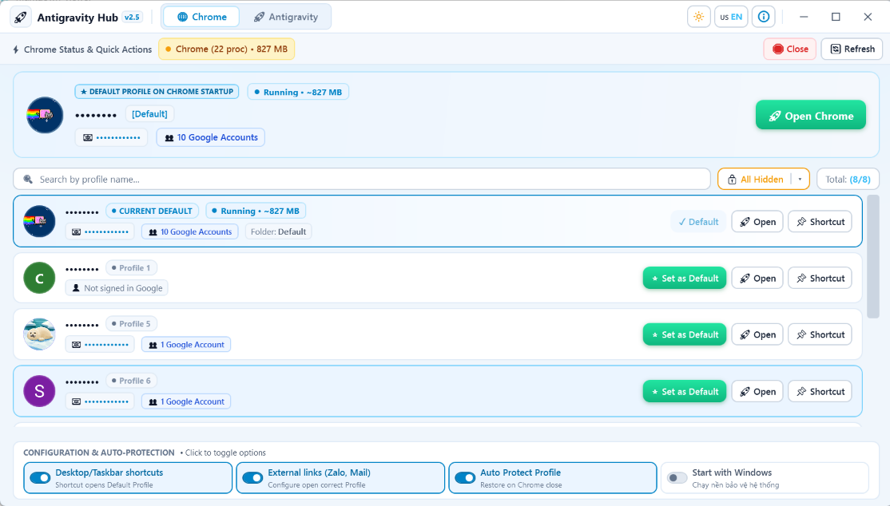

# 🚀 Antigravity Hub (v2.5 Pro)
### Hệ sinh thái Quản trị Antigravity AI, Hạn mức Model Quota & Workspace Chrome Profiles

<p align="center">
  
</p>

<p align="center">
  <strong>Trung tâm điều hành tối thượng dành cho Lập trình viên AI & Người dùng Google Chrome đa tài khoản</strong>
</p>

<p align="center">
  
  
  
  
  
</p>

<p align="center">
  🌐 <strong>Chọn ngôn ngữ tài liệu / Documentation Language:</strong><br />
  <a href="README.md"><b>🇺🇸 English (Mặc định)</b></a> &nbsp;&nbsp;|&nbsp;&nbsp;
  <a href="README_VI.md"><b>🇻🇳 Tiếng Việt</b></a>
</p>

---

## 📑 Mục lục
1. [Giới thiệu tổng quan](#-giới-thiệu-tổng-quan)
2. [Tính năng cốt lõi](#-tính-năng-cốt-lõi)
   - [Phân hệ 1: Antigravity AI Ecosystem & Quota Monitor](#1-phân-hệ-antigravity-ai-ecosystem--quota-monitor)
   - [Phân hệ 2: Google Chrome Profile & Workspace Manager](#2-phân-hệ-google-chrome-profile--workspace-manager)
   - [Trải nghiệm giao diện & Bảo mật thông tin](#3-trải-nghiệm-giao-diện--bảo-mật-thông-tin)
3. [Tải về & Cài đặt](#-tải-về--cài-đặt)
4. [Hướng dẫn sử dụng](#-hướng-dẫn-sử-dụng)
   - [Quản lý tài khoản & Hạn mức Antigravity AI](#hướng-dẫn-quản-trị-antigravity-ai)
   - [Thiết lập Chrome Profile mặc định 3 lớp](#hướng-dẫn-cấu-hình-chrome-profile-mặc-định)
   - [Sao lưu & Khôi phục lịch sử Chat](#hướng-dẫn-chat-backup--restore)
   - [Đổi ngôn ngữ giao diện (Anh / Việt)](#hướng-dẫn-đổi-ngôn-ngữ-giao-diện-anh--việt)
5. [Hướng dẫn Biên dịch & Đóng gói (Build)](#-hướng-dẫn-biên-dịch--đóng-gói-build)
6. [Cấu trúc mã nguồn](#-cấu-trúc-mã-nguồn)
7. [Tác giả & Liên hệ](#-tác-giả--liên-hệ)

---

## 🌟 Giới thiệu tổng quan

**Antigravity Hub** là giải pháp phần mềm chuyên nghiệp trên Windows kết hợp hai nhu cầu thiết yếu nhất của lập trình viên hiện đại:
1. **Quản trị đa tài khoản Antigravity AI (IDE & CLI):** Giúp chuyển đổi tài khoản Google/AI tức thì (*Zero-Crash Hot Switching*), theo dõi trực quan hạn mức token/quota (Gemini 2.5 Pro, Flash, Claude 3.5 Sonnet...), tự động cấp mới token và bảo vệ lịch sử hội thoại chat.
2. **Quản lý đa không gian làm việc Google Chrome:** Cung cấp cơ chế khóa và đặt Profile mặc định 3 lớp độc quyền (Local State + Windows Shortcuts + Registry Links), kèm dịch vụ chạy ngầm tự động bảo vệ cấu hình Chrome khi tắt duyệt trình.

Ứng dụng được xây dựng hoàn toàn trên nền tảng **.NET 9.0 WPF**, tích hợp kiến trúc đồ họa hiện đại, hiệu ứng kính mờ (Glassmorphism), bảng màu chuẩn Windows 11 Fluent, song ngữ Anh – Việt và tối ưu hóa hiệu năng 60 FPS.

---

## ⚡ Tính năng cốt lõi

### 1. Phân hệ Antigravity AI Ecosystem & Quota Monitor

<p align="center">
  
  <br />
  <em>📸 Giao diện Quản trị Antigravity AI: Bảng đo Quota đa model, theo dõi hồi phục 5h/tuần & Hoán đổi tài khoản Zero-Crash</em>
</p>

* 🔄 **Zero-Crash Hot Account Switching:**
  - Chuyển đổi giữa hàng chục tài khoản Antigravity AI chỉ với 1 cú click chuột mà không cần khởi động lại toàn bộ máy tính hay lo lắng về việc xung đột dữ liệu phiên đăng nhập.
  - Hỗ trợ linh hoạt mục tiêu kích hoạt: **Antigravity IDE**, **Antigravity CLI (`agy`)**, hoặc **Antigravity Standalone**.
* 📊 **Bảng theo dõi Hạn mức Model Quota chuyên sâu (Model Quota Dashboard):**
  - Giám sát đồng thời hạn mức 5 Giờ (*5-Hour Quota*) và hạn mức Tuần (*Weekly Quota*).
  - Phân tích chi tiết từng model: Gemini 2.5 Pro, Gemini 2.5 Flash, Claude 3.5 Sonnet, Claude 3.5 Haiku, Claude Opus...
  - Bộ đếm thời gian hồi phục tự động (*Live Countdown Timer*): Thông báo chính xác thời điểm model sẵn sàng phục vụ tiếp theo.
* 🤖 **Tự động đo lường & Cấp mới Token ngầm (Auto-Refresh & Batch Measure):**
  - Tự động chạy ngầm đo lường quota định kỳ (tùy chỉnh 15 phút, 30 phút, 1 giờ...).
  - Cơ chế đa luồng đo lường song song (*Concurrency Control*) giúp kiểm tra hàng chục tài khoản trong vài giây mà không bị nghẽn mạng.
* 💾 **Bảo vệ & Phục hồi Hội thoại Chat (Chat Session Restorer):**
  - Tự động sao lưu lịch sử chat (`chatSessionStore.json`, `trajectorySummaries`, sidebar workspaces) trước mỗi lần đổi tài khoản.
  - Phục hồi lại toàn bộ đoạn chat dang dở sang tài khoản mới một cách nguyên vẹn.
* 🔐 **Silent OAuth & Consent Automation:**
  - Tích hợp máy chủ lắng nghe OAuth cục bộ giúp kết nối và đồng bộ tài khoản Google mới hoàn toàn tự động và an toàn.

---

### 2. Phân hệ Google Chrome Profile & Workspace Manager

<p align="center">
  
  <br />
  <em>📸 Giao diện Quản lý Chrome Profiles: Đặt Profile mặc định 3 lớp, bảo vệ ngầm Profile Guard & Theo dõi tiến trình RAM</em>
</p>

* 🎯 **Cơ chế thiết lập Profile mặc định 3 lớp độc quyền:**
  - **Lớp 1 – Cấu hình nội tại Chrome (`Local State`):** Khóa thông số `profile.last_used` và tắt hộp thoại hỏi chọn profile khi bật máy (`show_picker_on_startup: false`).
  - **Lớp 2 – Tự động cập nhật Phím tắt (Shortcuts):** Tự động rà soát Desktop, Taskbar và Start Menu để gắn tham số chuẩn `--profile-directory="<Profile>"` vào mọi shortcut Chrome.
  - **Lớp 3 – Ghi đè Registry mở Link ngoài (`ChromeHTML`):** Cấu hình chuẩn trong `HKCU\Software\Classes\ChromeHTML`, đảm bảo khi click link từ Zalo, Telegram, Outlook, Word, Excel... Chrome luôn mở chính xác Profile làm việc bạn chỉ định.
* 🛡️ **Dịch vụ bảo vệ tự động (Profile Guard Service):**
  - Theo dõi ngầm sự kiện đóng/mở của Google Chrome.
  - Tự động khôi phục Profile mặc định ngay khi người dùng tắt Chrome, ngăn chặn Chrome tự ý tráo đổi tài khoản khi bạn vô tình mở profile khác.
* 📈 **Giám sát Tiến trình & Bộ nhớ RAM Chrome thời gian thực:**
  - Hiển thị trực quan số lượng tiến trình Chrome đang mở và tổng dung lượng RAM đang chiếm dụng.
  - Cung cấp nút dọn dẹp / tắt nhanh toàn bộ tiến trình Chrome chỉ với 1 click.

---

### 3. Trải nghiệm giao diện & Bảo mật thông tin

* 🌐 **Đa ngôn ngữ toàn diện (Chuyển đổi tức thì 🇻🇳 VI / 🇺🇸 EN):**
  - Nút chuyển đổi nằm ngay tại **thanh Header góc trên bên phải** (nút hiển thị `🇻🇳 VI` hoặc `🇺🇸 EN`).
  - Chỉ với **1 cú nhấp chuột**, toàn bộ giao diện, các nhãn thao tác, tooltip hướng dẫn và hộp thoại hệ thống sẽ chuyển đổi qua lại giữa **Tiếng Việt** và **Tiếng Anh** tức thì mà không cần khởi động lại phần mềm.
* 🌓 **Hỗ trợ Giao diện Sáng / Tối (Light & Dark Mode):** Nút biểu tượng Mặt trời/Mặt trăng ở góc phải giúp chuyển đổi theme mượt mà theo sở thích hoặc theo phong cách hệ điều hành.
* 👁️ **Chế độ Riêng tư (Privacy Shield):** Cho phép ẩn/mờ tên người dùng và email trên giao diện khi quay video màn hình, chia sẻ tài liệu hoặc livestream làm việc.
* 🔔 **Chạy nền Khay hệ thống (System Tray):**
  - Thu nhỏ gọn gàng xuống góc đồng hồ khi nhấn nút đóng.
  - Menu chuột phải giúp chuyển đổi tài khoản tức thì, mở nhanh Chrome hoặc IDE.
  - Tùy chọn tự khởi động cùng Windows khi bật máy.

---

## 📦 Tải về & Cài đặt

Người dùng có thể lựa chọn 1 trong 2 phiên bản tùy theo nhu cầu:

| Phiên bản | Định dạng | Mô tả & Khuyên dùng | Đường dẫn file |
| :--- | :--- | :--- | :--- |
| **Bản Cài Đặt (Setup)** | `*.exe` Installer | Cài đặt chuẩn vào Windows, tự tạo Shortcut Desktop, Menu Start và hỗ trợ gỡ cài đặt sạch sẽ. *(Khuyên dùng)* | [`dist/Setup/AntigravityHub_Setup_v2.5.exe`](file:///c:/Users/admin/source/repos/ProxySwicher/dist/Setup/AntigravityHub_Setup_v2.5.exe) |
| **Bản Di Động (Portable)** | `*.exe` Single-File | Không cần cài đặt, copy vào USB hoặc bất kỳ thư mục nào là chạy ngay lập tức. | [`dist/Portable/AntigravityHub.exe`](file:///c:/Users/admin/source/repos/ProxySwicher/dist/Portable/AntigravityHub.exe) |

> [!NOTE]
> Ứng dụng là phần mềm chạy độc lập (Self-Contained 64-bit), **không yêu cầu cài thêm .NET Runtime** trên máy tính của bạn.

---

## 📖 Hướng dẫn sử dụng

### Hướng dẫn Quản trị Antigravity AI
1. Khởi động **Antigravity Hub** và chọn tab **🚀 Antigravity** trên thanh điều hướng.
2. Danh sách tài khoản đã đăng nhập sẽ tự động hiển thị cùng thanh hạn mức Quota còn lại.
3. **Đổi tài khoản:** Bấm vào nút **Kích hoạt** trên tài khoản mong muốn. Hệ thống sẽ tự động hoán đổi phiên xác thực trong tích tắc mà không làm treo IDE.
4. **Xem bảng Model Quota:** Nhấp chuột vào huy hiệu quota hoặc icon bảng hạn mức trên từng tài khoản để mở cửa sổ chi tiết tiến độ hồi phục của từng model Gemini / Claude.
5. **Đo lường toàn bộ:** Nhấp nút **Đo lường tất cả** trên thanh công cụ để cập nhật dữ liệu quota mới nhất cho toàn bộ danh sách.

### Hướng dẫn Cấu hình Chrome Profile mặc định
1. Chọn tab **🌐 Chrome** trên thanh điều hướng.
2. Danh sách toàn bộ Profile có trên máy tính sẽ hiển thị trực quan kèm Avatar và số lượng tài khoản Google bên trong.
3. Bấm **⭐ Đặt làm mặc định** tại Profile bạn muốn dùng làm không gian làm việc chính.
4. Bật các tùy chọn tại thanh cấu hình phía dưới:
   - `Desktop/Taskbar shortcuts`: Tự động gắn Profile vào shortcut.
   - `Mở link ngoài (Zalo, Mail)`: Mở đúng Profile khi click liên kết bên ngoài.
   - `Tự động bảo vệ Profile`: Duy trì khôi phục Profile khi tắt Chrome.

### Hướng dẫn Chat Backup & Restore
- Tính năng này hoạt động hoàn toàn tự động. Trước khi hoán đổi tài khoản, ứng dụng sẽ lưu trữ một bản snapshot của các cuộc hội thoại.
- Bạn có thể tra cứu và khôi phục lại các phiên trò chuyện từ danh mục quản lý tài khoản bất cứ lúc nào.

### Hướng dẫn Đổi ngôn ngữ giao diện (Anh / Việt)
- Nhấp vào nút ngôn ngữ ở **thanh tiêu đề góc trên bên phải** (hiển thị `🇻🇳 VI` hoặc `🇺🇸 EN`).
- Toàn bộ giao diện phần mềm sẽ được đổi sang ngôn ngữ đã chọn ngay lập tức mà không cần khởi động lại.

---

## 🛠️ Hướng dẫn Biên dịch & Đóng gói (Build)

Nếu bạn là nhà phát triển muốn tự biên dịch hoặc đóng gói lại mã nguồn:

### Yêu cầu môi trường
* Hệ điều hành: Windows 10 / Windows 11 (64-bit).
* SDK: [.NET 9.0 SDK](https://dotnet.microsoft.com/download/dotnet/9.0) trở lên.
* Bộ đóng gói Installer: [Inno Setup 6](https://jrsoftware.org/isdl.php) (Script tự động cài đặt qua `winget` nếu máy chưa có).

### Các bước đóng gói tự động

Chạy file kịch bản điều khiển đi kèm:
```cmd
build.bat
```
Hoặc thực thi qua PowerShell:
```powershell
.\build.ps1 -Target All
```

**Các tùy chọn build:**
- `[1] Build Portable`: Tạo file `.exe` chạy luôn tại `dist/Portable/AntigravityHub.exe`.
- `[2] Build Setup`: Biên dịch và tạo bộ cài đặt Windows tại `dist/Setup/AntigravityHub_Setup_v2.5.exe`.
- `[3] Build CẢ HAI`: Tự động xây dựng cả bản Portable và bộ cài Setup chỉ với một lệnh duy nhất.

---

## 📂 Cấu trúc mã nguồn

```
ProxySwicher/
├── ProfileSwitchChrome - Sao chép/
│   ├── Models/                           # Định nghĩa đối tượng dữ liệu
│   │   ├── AntigravityAccountInfo.cs     # Cấu trúc tài khoản, token & quota AI
│   │   └── ChromeProfileInfo.cs          # Cấu trúc Chrome profile & avatar
│   ├── Services/                         # Các dịch vụ xử lý logic cốt lõi
│   │   ├── AntigravityProfileManager.cs  # Điều phối tài khoản AI, quota, chat & IDE
│   │   ├── AntigravityChatRestorer.cs    # Sao lưu & khôi phục lịch sử hội thoại
│   │   ├── ChromeProfileManager.cs       # Đọc Local State, điều hướng shortcut Chrome
│   │   ├── ProfileGuardService.cs        # Dịch vụ chạy ngầm bảo vệ Profile
│   │   ├── AppConfig.cs                  # Quản lý cấu hình, lưu trữ & registry
│   │   ├── ThemeManager.cs               # Quản lý chủ đề Dark/Light
│   │   └── LocalizationManager.cs        # Quản lý ngôn ngữ Tiếng Việt / Tiếng Anh
│   ├── MainWindow.xaml                   # Giao diện chính chuẩn Fluent WPF
│   ├── MainWindow.xaml.cs                # Điều khiển logic hiển thị & tương tác UI
│   ├── ModelQuotaWindow.xaml             # Bảng chi tiết hạn mức Model Quota
│   ├── app.manifest                      # Khai báo đặc quyền Windows Administrator
│   ├── installer.iss                     # Kịch bản đóng gói Inno Setup 6
│   ├── build.bat                         # Kịch bản build tự động nhanh
│   └── ProfileSwitchChrome.csproj        # Cấu hình dự án .NET 9.0
├── dist/                                 # Thư mục chứa sản phẩm sau khi build
│   ├── Portable/                         # Chứa AntigravityHub.exe (Bản chạy luôn)
│   └── Setup/                            # Chứa AntigravityHub_Setup_v2.5.exe (Bộ cài đặt)
├── build.bat                             # Script chạy build ở thư mục gốc
├── build.ps1                             # Script PowerShell pipeline
├── README.md                             # Tài liệu tiếng Anh (Mặc định)
└── README_VI.md                          # Tài liệu tiếng Việt
```

---

## 👨‍💻 Tác giả & Liên hệ

* **Tác giả:** Phùng Toàn (*DvenxyWiks*)
* **GitHub:** [https://github.com/wiksgods](https://github.com/wiksgods)
* **Telegram:** [@DvenxyWiks](https://t.me/DvenxyWiks)
* **Phiên bản hiện tại:** `v2.5.0 Pro`

---

<p align="center">
  Phát triển với ❤️ và đam mê công nghệ. Chúc bạn có trải nghiệm làm việc năng suất vượt bậc cùng <strong>Antigravity Hub</strong>!
</p>
